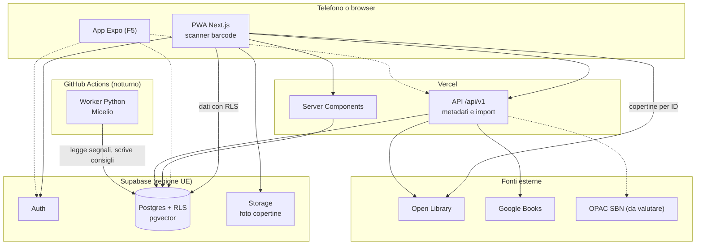

# Architettura

Un solo sviluppatore, costi a zero e pochi utenti all'inizio, senza chiudersi la strada verso il pubblico e un'app mobile. La regola è usare pochi pezzi, ben integrati. Le decisioni sono motivate negli [ADR](adr/).

## Vista d'insieme



## Struttura della repo (a fine F0)

```text
apps/web/            Next.js: pagine, componenti, API /api/v1
apps/mobile/         App Expo, solo dalla F5
packages/domain/     Logica pura: ISBN, parser degli import, regole, schemi di validazione
packages/data/       Accesso ai dati via Supabase, senza React né Next.js
packages/i18n/       Messaggi per lingua (messages/it.json)
packages/tokens/     Design token in JSON, da cui si genera il CSS
supabase/
  migrations/        Schema e policy RLS, unica fonte dello schema
  tests/             Test SQL delle policy
  seed.sql           Dati finti, mai dati reali di amici
ml/                  Worker Python del Micelio (uv, pytest)
tools/spikes/        Esperimenti usa e getta
data/private/        File personali, ignorati da git
docs/                Roadmap, architettura, ADR, design
```

## Stack proposto

| Area | Scelta | Motivo |
|---|---|---|
| Frontend | Next.js + TypeScript strict | Un solo linguaggio per UI e server, ecosistema ampio |
| Stile | Tailwind con token CSS | I token del design system guidano tutto |
| Lingue | next-intl, senza lingua nell'URL all'inizio | Traduzioni pronte da subito; un'altra lingua si aggiunge con un file di messaggi |
| App mobile | PWA ora, Expo in F5 | Un link da mandare agli amici, nessuno store; la logica è già riusabile |
| Barcode | `barcode-detector` (polyfill ZXing WASM) | iOS non implementa la Barcode Detection API |
| Database | Supabase Postgres + pgvector | Auth, RLS, storage ed embedding in un solo posto |
| Autorizzazione | Row Level Security | I permessi tra amici stanno vicino ai dati |
| Recommender | Python in batch su GitHub Actions | Ecosistema ML, nessun server sempre acceso |
| Test | Vitest, Playwright, pgTAP, pytest | Ogni livello ha il suo strumento |

Prima dello scaffold, verifica le versioni correnti con `npm view <pacchetto> version`. Il 5 novembre 2026 risultavano Next.js 16.4, next-intl 4.14, Tailwind 4.3, `@supabase/supabase-js` 2.119, Vitest 5.1, Playwright 1.64, pnpm 12.16.

## Fonti dei metadati

| Fonte | Uso | Limiti verificati |
|---|---|---|
| **Open Library** | Prima fonte per opere, edizioni e copertine | 1 richiesta/s senza identificazione, 3/s con `User-Agent` contenente app e contatto. Niente download massivi via API: esistono i dump mensili. Dati del catalogo aperti |
| **Google Books** | Integrazione, utile sui libri italiani (ipotesi da misurare) | Richiede API key o OAuth; ricerca con `isbn:` e `langRestrict`. Controllare quote e termini sulla conservazione dei dati prima di salvarli |
| **OPAC SBN** | Possibile fonte per i libri italiani | Non ho trovato un'API pubblica documentata. Esiste un vecchio plugin Python `isbnlib-sbn` (2020). Da valutare nello spike |
| **Inserimento manuale** | Sempre disponibile | È la rete di sicurezza |

**Fonti escluse:** l'API Goodreads (nessuna nuova chiave dal dicembre 2020); l'API Hardcover (beta, pensata per uso offline o da backend con il proprio token, non per alimentare un altro catalogo); qualsiasi forma di scraping.

### Copertine

- Salva in `editions` il `cover_id` di Open Library e costruisci gli URL per ID: `https://covers.openlibrary.org/b/id/<id>-M.jpg`. Il limite di 100 richieste ogni 5 minuti per IP si applica agli accessi con ID diversi da CoverID e OLID, quindi anche per ISBN.
- Carica le copertine direttamente da `covers.openlibrary.org` e aggiungi un link di cortesia a Open Library nella pagina "Informazioni".
- Senza copertina, genera una copertina illustrata da titolo e autore. È un'occasione di design, non un ripiego.

### Pipeline di aggiunta di un libro

1. Normalizza l'input: ripulisci l'ISBN, converti ISBN-10 in ISBN-13, verifica la cifra di controllo.
2. Cerca prima nel catalogo locale.
3. Interroga le fonti in cascata, nell'ordine deciso dallo spike, con timeout brevi.
4. Unisci i risultati campo per campo, conservando la provenienza in `external_ids` e nel payload grezzo.
5. Collega l'edizione a un'opera esistente, se la corrispondenza è sicura; altrimenti creane una nuova, che potrà essere unita in seguito.
6. Se nessuna fonte risponde, apri l'inserimento manuale con i dati già noti.

### Import di librerie grandi

L'import procede a blocchi guidati dal browser: il client invia un blocco, il server lo elabora rispettando i limiti delle fonti, l'avanzamento vive in `import_jobs`. Si può riprendere dopo un'interruzione e non richiede code né server aggiuntivi. Le corrispondenze dubbie finiscono in una schermata di revisione.

### Import da Goodreads

L'export conserva voti, scaffali e **data di fine lettura**, che a volte manca, ma **non la data di inizio**. Il parser non deve mai dedurre date da `Date Added`. Le date mancanti restano vuote, e l'app guida a completarle. Il metodo per recuperare quelle di inizio si decide in F1.8, senza scraping automatico. Dettagli in `.claude/skills/metadati-libri/goodreads-csv.md`.

### Metodo dello spike F0.2

1. Scarica l'export da Goodreads e salvalo, senza aprirlo in Excel, in `data/private/`.
2. Scegli 50 libri con ISBN: circa 35 italiani (grandi editori, piccoli editori, traduzioni, vecchie edizioni) e 15 stranieri. Le regole della repo impediscono a Claude di aprire quella cartella: legge tutto lo script, che stampa solo i dati aggregati.
3. Per ogni fonte misura: edizione trovata, titolo corretto, autore, traduttore, descrizione, numero pagine, copertina.
4. Riassumi i risultati aggregati in un nuovo ADR. Le ipotesi sulla copertura italiana diventano numeri.

## Portabilità verso mobile e pubblico

Regole che costano poco ora e risparmiano una riscrittura dopo. Motivazioni in [ADR-0005](adr/0005-portabilita-mobile-e-pubblico.md).

- **Logica fuori da Next.js.** Regole e accesso ai dati stanno in `packages/`, senza dipendenze da React DOM o Next.js. Le Server Actions, se usate, si limitano a richiamare quei pacchetti.
- **Due vie verso il backend.** I dati passano dal client Supabase con RLS, che funziona anche da mobile. Ciò che richiede segreti o servizi esterni passa da `/api/v1`, con autenticazione tramite token Supabase e schemi di validazione condivisi.
- **Sessione portabile.** Le API accettano `Authorization: Bearer`, non solo i cookie del browser.
- **API versionate.** Una versione dell'app installata sul telefono può restare in uso a lungo: i cambi incompatibili richiedono `/api/v2`.
- **Testi e token portabili.** Messaggi e token stanno in JSON, leggibili anche da Expo.
- **Nessuna cerchia nel codice.** Le amicizie sono tra coppie di persone; l'accesso dipende da `profiles.status` e `app_settings`.
- **Lingua come dato.** Date e numeri con `Intl`, lingua nel profilo, `language` su ogni edizione.

## Autenticazione e permessi

- Login con Google, gestito da Supabase. La configurazione in Google Cloud va fatta una volta sola. Motivazioni in [ADR-0006](adr/0006-accesso-a-costo-zero.md).
- Chiunque può autenticarsi, ma l'app si usa solo con `profiles.status = active`. Finché `signup_mode` è `invite_only`, un account diventa attivo riscattando un invito.
- Tutte le tabelle hanno RLS attiva; la `secret key` di Supabase non arriva mai al browser.
- Il worker `ml/` usa un ruolo Postgres dedicato, con scrittura limitata alle tabelle del recommender, non la chiave di servizio.
- La logica di amicizia passa da una funzione `are_friends()` riusata nelle policy.

## Costi e limiti

Obiettivo: **0 € finché l'app è privata**.

| Servizio | Piano gratuito | Attenzione | All'apertura |
|---|---|---|---|
| Supabase | 500 MB di database, 1 GB di storage, 5 GB di egress mensili, 2 progetti | **Pausa con bassa attività su 7 giorni**; ripristino manuale fino a 1 anno. Verificare i backup del piano gratuito | Pro, da 25 $/mese, senza pausa |
| Email di Supabase | 2 email/ora | **Consegna solo ai membri del team del progetto**: inutilizzabile per gli amici | SMTP esterno, con dominio |
| Vercel Hobby | 100 GB di traffico, 1 milione di invocazioni, 4 ore di CPU attiva, 5.000 trasformazioni immagine | Solo uso personale non commerciale. Le donazioni sono ammesse; pagamenti, pubblicità e guadagni richiedono Pro | Pro, 20 $/mese per sviluppatore, se ci sono entrate |
| GitHub Actions | Gratuito per repo pubbliche | Sulle repo pubbliche i workflow pianificati si disattivano dopo 60 giorni senza attività nella repo, e possono subire ritardi | Worker dedicato, se i tempi non bastano |
| Google Books | Chiave gratuita | Quote da verificare durante lo spike | Catalogo locale |
| Dominio | `*.vercel.app` gratuito | Link meno belli e niente email proprie | Dominio a pagamento |

Conseguenze pratiche:

- Il job di F0.8 esegue una vera lettura del database ogni giorno. Se GitHub lo disattiva, l'app prima o poi va in pausa: va riattivato a mano.
- Le copertine evitano l'ottimizzazione immagini di Vercel, per non consumare la quota: si caricano già piccole da Open Library.
- Niente login via email né notifiche email fino alla F5.
- Se il traffico superasse le quote, Vercel Hobby ferma la funzione interessata fino a 30 giorni: è accettabile per una beta tra amici, non per un servizio pubblico.

Il dimensionamento di pgvector è sostenibile: un vettore a 1024 dimensioni in float4 occupa circa 4 KB, quindi 10.000 opere richiedono circa 40 MB di soli vettori, indici esclusi. Con `halfvec` si dimezza.

## Privacy

I dati degli amici sono dati personali, anche se l'app è piccola.

- Hosting in UE, raccolta minima, cancellazione dell'account effettiva.
- Testo chiaro nell'invito su cosa vedono gli amici.
- La repo è pubblica: nessun dato reale in `seed.sql`, nei test o nei log.
- Una persona che prende in prestito un libro senza essere nell'app viene registrata solo con il nome scelto dal proprietario.

## Fonti

- [Open Library: API](https://openlibrary.org/developers/api), [Covers API](https://openlibrary.org/dev/docs/api/covers), [uso dei dati](https://openlibrary.org/help/faq/using)
- [Google Books API: Using the API](https://developers.google.com/books/docs/v1/using)
- [Hardcover API: Getting Started](https://docs.hardcover.app/api/getting-started)
- [Goodreads: API deprecation](https://www.goodreads.com/topic/show/21788520-api-deprecation)
- [isbnlib-sbn](https://www.pypi.org/project/isbnlib-sbn/)
- [Date mancanti nell'export Goodreads](https://www.goodreads.com/topic/show/22566611-read-dates-are-missing----sometimes?page=1) e [assenza della data di inizio](https://www.librarything.com/topic/152083)
- [Barcode scanning su iOS](https://eringen.substack.com/p/barcode-scanning-on-ios-the-missing)
- [Prezzi Supabase 2026 (MakerKit)](https://makerkit.dev/blog/md/saas/supabase-pricing), fonte secondaria da ricontrollare su supabase.com
- [Supabase: pausa dei progetti gratuiti](https://supabase.com/docs/guides/platform/free-project-pausing)
- [Supabase: SMTP personalizzato](https://supabase.com/docs/guides/auth/auth-smtp) e [limiti di Auth](https://supabase.com/docs/guides/auth/rate-limits)
- [Supabase da app mobile](https://supabase.com/kb/faqs/database/mobile-app-database)
- [Vercel: piano Hobby](https://vercel.com/docs/plans/hobby) e [uso commerciale](https://vercel.com/docs/limits/fair-use-guidelines)
- [GitHub: workflow pianificati](https://docs.github.com/actions/managing-workflow-runs/disabling-and-enabling-a-workflow)
- [next-intl senza routing per lingua](https://next-intl.dev/docs/getting-started/app-router/without-i18n-routing)
- [Apple App Review Guidelines](https://developer.apple.com/app-store/review/guidelines/)
