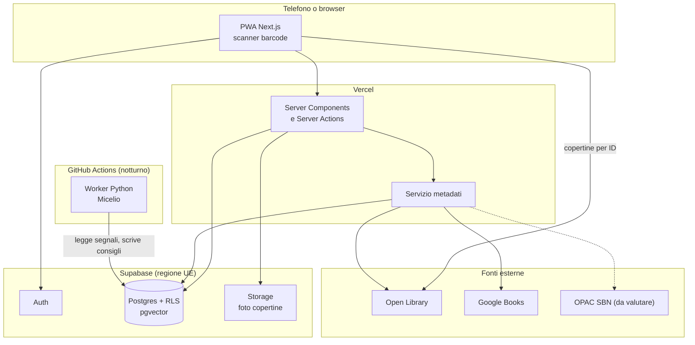

# Architettura

Progetto per decine di utenti e un solo sviluppatore: la regola è usare pochi pezzi, ben integrati. Le decisioni sono motivate negli [ADR](adr/); fino alla F0.1 sono proposte.

## Vista d'insieme



## Struttura della repo (a fine F0)

```text
apps/web/            Next.js: pagine, componenti, Server Actions
packages/domain/     Logica pura condivisa: ISBN, parser degli import, regole
supabase/
  migrations/        Schema e policy RLS, unica fonte dello schema
  tests/             Test SQL delle policy
  seed.sql           Dati finti, mai dati reali di amici
ml/                  Worker Python del Micelio (uv, pytest)
tools/spikes/        Esperimenti usa e getta
data/private/        File personali, ignorati da git
docs/                Roadmap, architettura, ADR, design
```

## Stack proposto

| Area | Scelta | Motivo |
|---|---|---|
| Frontend | Next.js + TypeScript strict | Un solo linguaggio per UI e server, ecosistema ampio |
| Stile | Tailwind con token CSS | I token del design system guidano tutto |
| App mobile | PWA | Un link da mandare agli amici, nessuno store |
| Barcode | `barcode-detector` (polyfill ZXing WASM) | iOS non implementa la Barcode Detection API |
| Database | Supabase Postgres + pgvector | Auth, RLS, storage ed embedding in un solo posto |
| Autorizzazione | Row Level Security | I permessi tra amici stanno vicino ai dati |
| Recommender | Python in batch su GitHub Actions | Ecosistema ML, nessun server sempre acceso |
| Test | Vitest, Playwright, pgTAP, pytest | Ogni livello ha il suo strumento |

Prima dello scaffold, verifica le versioni correnti con `npm view <pacchetto> version`. Il 5 novembre 2026 risultavano Next.js 16.4, Tailwind 4.3, `@supabase/supabase-js` 2.119, Vitest 5.1, Playwright 1.64, pnpm 12.16.

## Fonti dei metadati

| Fonte | Uso | Limiti verificati |
|---|---|---|
| **Open Library** | Prima fonte per opere, edizioni e copertine | 1 richiesta/s senza identificazione, 3/s con `User-Agent` contenente app e contatto. Niente download massivi via API: esistono i dump mensili. Dati del catalogo aperti |
| **Google Books** | Integrazione, utile sui libri italiani (ipotesi da misurare) | Richiede API key o OAuth; ricerca con `isbn:` e `langRestrict`. Controllare quote e termini sulla conservazione dei dati prima di salvarli |
| **OPAC SBN** | Possibile fonte per i libri italiani | Non ho trovato un'API pubblica documentata. Esiste un vecchio plugin Python `isbnlib-sbn` (2020). Da valutare nello spike |
| **Inserimento manuale** | Sempre disponibile | È la rete di sicurezza |

**Fonti escluse:** l'API Goodreads (nessuna nuova chiave dal dicembre 2020); l'API Hardcover (beta, pensata per uso offline o da backend con il proprio token, non per alimentare un altro catalogo); qualsiasi forma di scraping.

### Copertine

- Salva in `editions` il `cover_id` di Open Library e costruisci gli URL per ID: `https://covers.openlibrary.org/b/id/<id>-M.jpg`. Il limite di 100 richieste ogni 5 minuti per IP si applica agli accessi con ID diversi da CoverID e OLID, quindi anche per ISBN.
- Carica le copertine direttamente da `covers.openlibrary.org` e aggiungi un link di cortesia a Open Library nella pagina "Informazioni".
- Senza copertina, genera una copertina illustrata da titolo e autore. È un'occasione di design, non un ripiego.

### Pipeline di aggiunta di un libro

1. Normalizza l'input: ripulisci l'ISBN, converti ISBN-10 in ISBN-13, verifica la cifra di controllo.
2. Cerca prima nel catalogo locale.
3. Interroga le fonti in cascata, nell'ordine deciso dallo spike, con timeout brevi.
4. Unisci i risultati campo per campo, conservando la provenienza in `external_ids` e nel payload grezzo.
5. Collega l'edizione a un'opera esistente, se la corrispondenza è sicura; altrimenti creane una nuova, che potrà essere unita in seguito.
6. Se nessuna fonte risponde, apri l'inserimento manuale con i dati già noti.

### Import di librerie grandi

L'import procede a blocchi guidati dal browser: il client invia un blocco, il server lo elabora rispettando i limiti delle fonti, l'avanzamento vive in `import_jobs`. Si può riprendere dopo un'interruzione e non richiede code né server aggiuntivi. Le corrispondenze dubbie finiscono in una schermata di revisione.

### Metodo dello spike F0.2

1. Scegli 50 libri fisici della tua libreria: circa 35 italiani (grandi editori, piccoli editori, traduzioni, vecchie edizioni) e 15 stranieri.
2. Salva gli ISBN in `data/private/spike-isbn.csv`. Le regole della repo impediscono a Claude di aprirlo: lo legge lo script, che stampa solo i dati aggregati.
3. Per ogni fonte misura: edizione trovata, titolo corretto, autore, traduttore, descrizione, numero pagine, copertina.
4. Riassumi i risultati aggregati in un nuovo ADR. Le ipotesi sulla copertura italiana diventano numeri.

## Autenticazione e permessi

- Magic link via email, senza password da gestire.
- Tutte le tabelle hanno RLS attiva; la `secret key` di Supabase non arriva mai al browser.
- Il worker `ml/` usa un ruolo Postgres dedicato, con scrittura limitata alle tabelle del recommender, non la chiave di servizio.
- La logica di amicizia passa da una funzione `are_friends()` riusata nelle policy.

## Costi e limiti da tenere d'occhio

| Servizio | Piano gratuito | Rischio |
|---|---|---|
| Supabase | 500 MB di database, 1 GB di storage, 5 GB di egress mensili, 2 progetti attivi | **Pausa dopo 7 giorni di inattività**, con riattivazione manuale. In Pro: da 25 $/mese |
| Vercel | Piano Hobby per uso non commerciale | Verificare limiti e cron quando si fa il deploy |
| GitHub Actions | Generoso per repo pubbliche | I job non devono esporre dati nei log, perché la repo è pubblica |

Il dimensionamento di pgvector è sostenibile: un vettore a 1024 dimensioni in float4 occupa circa 4 KB, quindi 10.000 opere richiedono circa 40 MB di soli vettori, indici esclusi. Con `halfvec` si dimezza.

## Privacy

I dati di una cerchia di amici sono dati personali, anche se l'app è piccola.

- Hosting in UE, raccolta minima, cancellazione dell'account effettiva.
- Testo chiaro nell'invito su cosa vedono gli amici.
- La repo è pubblica: nessun dato reale in `seed.sql`, nei test o nei log.
- Una persona che prende in prestito un libro senza essere nell'app viene registrata solo con il nome scelto dal proprietario.

## Fonti

- [Open Library: API](https://openlibrary.org/developers/api), [Covers API](https://openlibrary.org/dev/docs/api/covers), [uso dei dati](https://openlibrary.org/help/faq/using)
- [Google Books API: Using the API](https://developers.google.com/books/docs/v1/using)
- [Hardcover API: Getting Started](https://docs.hardcover.app/api/getting-started)
- [Goodreads: API deprecation](https://www.goodreads.com/topic/show/21788520-api-deprecation)
- [isbnlib-sbn](https://www.pypi.org/project/isbnlib-sbn/)
- [Barcode scanning su iOS](https://eringen.substack.com/p/barcode-scanning-on-ios-the-missing)
- [Prezzi Supabase 2026 (MakerKit)](https://makerkit.dev/blog/md/saas/supabase-pricing), fonte secondaria da ricontrollare su supabase.com
