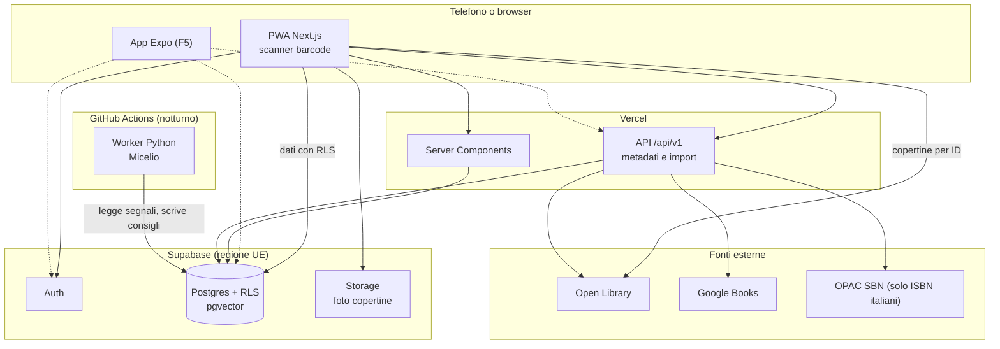

# Architettura

Un solo sviluppatore, costi a zero e pochi utenti all'inizio, senza chiudersi la strada verso il pubblico e un'app mobile. La regola è usare pochi pezzi, ben integrati. Le decisioni sono motivate negli [ADR](adr/).

## Vista d'insieme



## Struttura della repo (a fine F0)

```text
apps/web/            Next.js: pagine, componenti, API /api/v1
apps/mobile/         App Expo, solo dalla F5
packages/domain/     Logica pura: ISBN, parser degli import, regole, schemi di validazione
packages/data/       Accesso ai dati via Supabase, senza React né Next.js
packages/metadata/   Fonti dei metadati (Open Library, Google Books, SBN): client, parser, unione per campo; solo lato server, tranne `@libresca/metadata/client` (tipi delle risposte e funzioni pure per la schermata di aggiunta)
packages/i18n/       Messaggi per lingua (messages/it.json)
packages/tokens/     Design token in JSON, da cui si genera il CSS
supabase/
  migrations/        Schema e policy RLS, unica fonte dello schema
  tests/             Test SQL delle policy
  seed.sql           Dati finti, mai dati reali di amici
ml/                  Worker Python del Micelio (uv, pytest)
tools/spikes/        Esperimenti usa e getta
data/private/        File personali, ignorati da git
docs/                Roadmap, architettura, ADR, design
```

## Stack proposto

| Area | Scelta | Motivo |
|---|---|---|
| Frontend | Next.js + TypeScript strict | Un solo linguaggio per UI e server, ecosistema ampio |
| Stile | Tailwind con token CSS | I token del design system guidano tutto |
| Lingue | next-intl, senza lingua nell'URL all'inizio | Traduzioni pronte da subito; un'altra lingua si aggiunge con un file di messaggi |
| App mobile | PWA ora, Expo in F5 | Un link da mandare agli amici, nessuno store; la logica è già riusabile |
| Barcode | Barcode Detection API del browser, altrimenti `barcode-detector` (polyfill ZXing WASM, MIT) | iOS non implementa la Barcode Detection API. Il WASM (circa 1 MB) è copiato in `public/zxing/` da `scripts/copy-zxing-wasm.mjs` prima di `dev` e `build`, servito con cache immutabile e caricato solo quando serve, mai da una CDN |
| Database | Supabase Postgres + pgvector | Auth, RLS, storage ed embedding in un solo posto |
| Autorizzazione | Row Level Security | I permessi tra amici stanno vicino ai dati |
| Recommender | Python in batch su GitHub Actions | Ecosistema ML, nessun server sempre acceso |
| Test | Vitest, Playwright, pgTAP, pytest | Ogni livello ha il suo strumento |

Versioni scelte nello scaffold (F0.3, 7 novembre 2026): pnpm 12.18, Next.js 16.4, React 19.3, next-intl 4.14, Tailwind 4.3, Vitest 5.1, Playwright 1.65. Ci sono due eccezioni volute all'ultima versione:

- **TypeScript 6.0 e non 7:** typescript-eslint supporta TypeScript solo fino alla 6.0.
- **ESLint 9 e non 10:** i plugin React, import e jsx-a11y usati da `eslint-config-next` non supportano ancora ESLint 10.

Riprova a passare all'ultima versione quando cambiano le dipendenze. pnpm rifiuta i pacchetti pubblicati da meno di un giorno: meglio scegliere una versione precedente che aggiungere eccezioni.

## Fonti dei metadati

Ordine, priorità per campo e numeri dello spike F0.2 sono in [ADR-0008](adr/0008-cascata-fonti-metadati.md).

| Fonte | Uso | Limiti verificati |
|---|---|---|
| **Google Books** | Trova l'89% delle edizioni italiane del campione: serve a trovare il libro e completare la scheda | Chiave obbligatoria (quota anonima zero), solo lato server. Quota della chiave: 1.000 richieste al giorno e 100 al minuto per utente; il server passa `quotaUser`, un hash dell'ID dell'account, così il limite al minuto vale per persona. Attribuzione visibile non richiesta, da riverificare in F5.5. I termini vietano database e copie permanenti dei contenuti: si salva l'ID del volume, mentre descrizioni e copertine si mostrano dal vivo. Vietato far pagare l'app senza accordo con Google |
| **OPAC SBN** | Solo ISBN italiani: pagine affidabili e traduttori, 60% delle edizioni italiane | Dati in licenza CC0. Endpoint JSON non documentato `opac.sbn.it/opacmobilegw/`, usato a una richiesta al secondo. Niente descrizioni; la copertina che restituisce non è riutilizzabile |
| **Open Library** | Copertine e descrizioni aperte, ottima sui libri stranieri (93%), debole su quelli italiani (26%) | 1 richiesta/s senza identificazione, 3/s con `User-Agent` contenente app e contatto (`OPEN_LIBRARY_CONTACT`). Niente download massivi via API: esistono i dump mensili. Dati del catalogo aperti, ma alcune descrizioni sono copiate da Wikipedia (CC BY-SA): quelle si scartano |
| **Inserimento manuale** | Sempre disponibile | È la rete di sicurezza, soprattutto per le novità |

**Fonti escluse:** l'API Goodreads (nessuna nuova chiave dal dicembre 2020); l'API Hardcover (beta, pensata per uso offline o da backend con il proprio token, non per alimentare un altro catalogo); qualsiasi forma di scraping.

### Copertine

- Salva in `editions` il `cover_id` di Open Library e costruisci gli URL per ID: `https://covers.openlibrary.org/b/id/<id>-M.jpg`. Il limite di 100 richieste ogni 5 minuti per IP si applica agli accessi con ID diversi da CoverID e OLID, quindi anche per ISBN.
- Carica le copertine direttamente da `covers.openlibrary.org` e aggiungi un link di cortesia a Open Library nella pagina "Informazioni".
- Se Open Library non ha la copertina, usa quella di Google Books caricata dal vivo a partire dall'ID del volume. Non salvarne mai una copia.
- Senza copertina, genera una copertina illustrata da titolo e autore. È un'occasione di design, non un ripiego.

### Pipeline di aggiunta di un libro

1. Normalizza l'input: ripulisci l'ISBN, converti ISBN-10 in ISBN-13, verifica la cifra di controllo.
2. Cerca prima nel catalogo locale.
3. Interroga in parallelo, con timeout brevi, Open Library e Google Books, più SBN per i prefissi `978-88` e `979-12`.
4. Unisci i risultati campo per campo con le priorità dell'ADR-0008, conservando la provenienza in `external_ids`. Il payload grezzo si salva solo per le fonti aperte; da quello di SBN si toglie `copertina`, che contiene la chiave LibraryThing di SBN.

I passi 1-4 sono `GET /api/v1/books/isbn/{isbn}` (F1.2a), con la logica in `packages/metadata`. Accetta cookie o `Authorization: Bearer` e risponde solo agli account attivi. Restituisce `catalog` se l'edizione è già nel catalogo, senza interrogare le fonti; altrimenti `proposal`, con la fonte di ogni campo e lo stato di ogni fonte; `not_found` (404) se nessuna la conosce. Non salva nulla: la proposta diventa una voce del catalogo con `proposalToCatalogEntry` e `create_edition` solo dopo la conferma dell'utente. Ritmo per fonte (Open Library 3/s, SBN 1/s), timeout di 4 secondi e una piccola cache in memoria per istanza: un'ora per le fonti aperte, per Google Books solo quanto permette `Cache-Control`. Ogni account può fare 30 ricerche esterne al minuto. Una cache condivisa su Postgres arriverà con l'import (F1.8), dove i volumi la giustificano.

Senza ISBN si parte da `GET /api/v1/books/search?q=` (F1.2b), con testo libero (titolo, autore o tutti e due), stesso accesso e stesso limite al minuto. Interroga in parallelo il catalogo (`search_works`), Open Library (`search.json` con `lang=it`, che riporta per ogni opera tutti gli ISBN e la migliore edizione italiana) e Google Books; SBN no, perché il suo ritmo di una richiesta al secondo serve alla ricerca per ISBN. I risultati sono raggruppati per opera, con sotto le edizioni trovate: un volume di Google Books entra in un'opera di Open Library solo se ne condivide un ISBN, mai per il solo titolo; i volumi rimasti si raggruppano per titolo e primo autore, senza ID di opera. Ogni candidato che è già nel catalogo lo dice: `identifier` se condivide l'ID di opera di Open Library o un ISBN, `title_author` se ha lo stesso titolo normalizzato e un autore in comune, e in quel caso decide l'utente. Scelta un'edizione con ISBN, la scheda completa arriva dall'endpoint per ISBN. Negli e2e `METADATA_SOURCES=off` spegne le fonti esterne.

5. Collega l'edizione a un'opera esistente, se la corrispondenza è sicura; altrimenti creane una nuova, che potrà essere unita in seguito.
6. Se nessuna fonte risponde, apri l'inserimento manuale con i dati già noti.

I passi 5-6 sono la schermata `/add` (F1.3a). L'endpoint per ISBN segnala in `catalogWork` l'opera del catalogo con lo stesso ID di opera di Open Library: la nuova edizione va lì senza chiedere. Una corrispondenza solo per titolo e autore diventa una domanda all'utente. Il salvataggio è una Server Action che richiama i pacchetti: `editedCatalogEntry` applica le correzioni dell'utente (fonte `user` in `field_sources`), `findAuthorsByOpenLibraryIds` riusa gli autori già nel catalogo con lo stesso ID Open Library, `createEdition` valida e scrive. La proposta torna dal client, quindi è trattata come input dell'utente: la validano il dominio e il database.

Le foto di copertina (F1.3b) vanno nel bucket pubblico `covers` di Supabase Storage. Il browser ruota e riduce la foto a un JPEG con il lato lungo di 800 px (60–100 KB), poi una Server Action la carica in `{id account}/{uuid}.jpg`: il bucket accetta solo JPEG fino a 1 MB, e le policy lasciano scrivere solo gli account attivi, ciascuno nella propria cartella. Il percorso non si indovina, quindi una foto si raggiunge solo da un'edizione. Una foto sostituita o abbandonata nel modulo si cancella subito; una già usata da un'edizione non si può cancellare. Con 1 GB gratuito ci stanno oltre 10.000 copertine.

### Import di librerie grandi

L'import procede a blocchi guidati dal browser (F1.8). `POST /api/v1/imports` riceve il CSV, lo analizza di nuovo sul server con il parser di `packages/domain` e salva una riga per libro in `import_rows`; poi il browser chiama `POST /api/v1/imports/{id}/step` finché l'import non è finito. Ogni passo elabora al massimo 12 righe in 20 secondi (`maxDuration` 60): si riprende dopo un'interruzione e non richiede code né server aggiuntivi. La logica sta in `runImportStep` (`packages/data`), che riceve le fonti da `importSourcesFor` (`packages/metadata` dietro `/api/v1`).

Per ogni riga: l'edizione con lo stesso ID Goodreads o lo stesso ISBN nel catalogo; altrimenti Open Library e SBN, con le risposte condivise in Postgres per un mese; Google Books solo se le fonti aperte non trovano nulla, fino a 300 chiamate al giorno per import; se nessuna fonte conosce il libro, la scheda si crea dai dati dell'export. Senza ISBN si cerca prima nel catalogo e poi su Open Library: un risultato con lo stesso titolo e autore si accetta, quelli approssimativi finiscono nella revisione di `/import`. Rilanciare un export rielabora ogni riga: un libro già nella Tana non riceve nuove letture né copie, ma un voto troncato dal primo import (4,5 letto come 4) riprende i suoi quarti se nel frattempo non è stato cambiato.

### Import da Goodreads

L'export conserva voti, scaffali e **data di fine lettura**, che a volte manca, ma **non la data di inizio**. Il parser non deduce mai date da `Date Added`. Le date mancanti restano vuote e si completano dalla scheda del libro. Ogni libro letto si dà per posseduto: l'utente toglie a mano le copie che non ha. Dettagli in `.claude/skills/metadati-libri/goodreads-csv.md`.

### Spike F0.2

Lo script è `tools/spikes/metadata_coverage.py`. Legge l'export Goodreads in `data/private/`, sceglie fino a 35 ISBN italiani e 15 stranieri, interroga le tre fonti e stampa solo dati aggregati. Le risposte restano in cache in `data/private/spike-f02-cache/`. Per rifare la misura, per esempio dopo un nuovo export, rilancialo con `python tools/spikes/metadata_coverage.py`. I risultati sono nell'ADR-0008.

## Ambienti e deploy

| Ambiente | Web | Database |
|---|---|---|
| Locale | `pnpm dev` su `localhost:3000` | Supabase in Docker (`pnpm db:start`) |
| CI | Build di produzione per gli e2e | Solo Postgres, ricreato a ogni run |
| Preview | URL di Vercel per ogni PR | Progetto remoto `libresca`, lo stesso della produzione |
| Produzione | `libresca.vercel.app`, regione `fra1` | Progetto remoto `libresca` (`rvovshyvjgpsssuvvslu`), `eu-central-1` |

- Preview e produzione condividono il database finché non contiene dati reali di amici; il secondo progetto gratuito resta libero per uno staging.
- Il progetto Vercel ha Root Directory `apps/web`; Node 24 viene da `engines` in `apps/web/package.json`. La variabile `ENABLE_EXPERIMENTAL_COREPACK=1` fa usare a Vercel la versione di pnpm indicata in `packageManager`.
- Vercel riceve solo `NEXT_PUBLIC_SUPABASE_URL` e `NEXT_PUBLIC_SUPABASE_PUBLISHABLE_KEY`. La secret key si aggiunge solo quando `/api/v1` ne avrà bisogno, e mai con prefisso `NEXT_PUBLIC_`.
- Le migrazioni arrivano al remoto solo con `supabase db push --remote`, lanciato a mano dopo conferma; la CI non scrive mai sul database remoto.

## Portabilità verso mobile e pubblico

Regole che costano poco ora e risparmiano una riscrittura dopo. Motivazioni in [ADR-0005](adr/0005-portabilita-mobile-e-pubblico.md).

- **Logica fuori da Next.js.** Regole e accesso ai dati stanno in `packages/`, senza dipendenze da React DOM o Next.js. Le Server Actions, se usate, si limitano a richiamare quei pacchetti.
- **Due vie verso il backend.** I dati passano dal client Supabase con RLS, che funziona anche da mobile. Ciò che richiede segreti o servizi esterni passa da `/api/v1`, con autenticazione tramite token Supabase e schemi di validazione condivisi.
- **Sessione portabile.** Le API accettano `Authorization: Bearer`, non solo i cookie del browser.
- **API versionate.** Una versione dell'app installata sul telefono può restare in uso a lungo: i cambi incompatibili richiedono `/api/v2`.
- **Testi e token portabili.** Messaggi e token stanno in JSON, leggibili anche da Expo.
- **Nessuna cerchia nel codice.** Le amicizie sono tra coppie di persone; l'accesso dipende da `profiles.status` e `app_settings`.
- **Lingua come dato.** Date e numeri con `Intl`, lingua nel profilo, `language` su ogni edizione.

## Autenticazione e permessi

- Login con Google, gestito da Supabase. La configurazione in Google Cloud va fatta una volta sola. Motivazioni in [ADR-0006](adr/0006-accesso-a-costo-zero.md).
- Chiunque può autenticarsi, ma l'app si usa solo con `profiles.status = active`. Finché `signup_mode` è `invite_only`, un account diventa attivo riscattando un invito.
- La regola che decide la pagina (login, attesa, app) è `redirectFor` in `packages/domain/src/access.ts`; nel web la applica `apps/web/src/proxy.ts` a ogni richiesta, verificando il token con `getClaims()`. Le policy usano `private.is_active()`.
- Il primo account si attiva a mano dal SQL Editor di Supabase: `select private.activate_profile('email@esempio.it');`. La funzione non è eseguibile dall'API.
- Tutte le tabelle hanno RLS attiva; la `secret key` di Supabase non arriva mai al browser.
- Il worker `ml/` usa un ruolo Postgres dedicato, con scrittura limitata alle tabelle del recommender, non la chiave di servizio.
- La logica di amicizia passa da una funzione `are_friends()` riusata nelle policy.

## Costi e limiti

Obiettivo: **0 € finché l'app è privata**.

| Servizio | Piano gratuito | Attenzione | All'apertura |
|---|---|---|---|
| Supabase | 500 MB di database, 1 GB di storage, 5 GB di egress mensili, 2 progetti | **Pausa con bassa attività su 7 giorni**; ripristino manuale fino a 1 anno. Verificare i backup del piano gratuito | Pro, da 25 $/mese, senza pausa |
| Email di Supabase | 2 email/ora | **Consegna solo ai membri del team del progetto**: inutilizzabile per gli amici | SMTP esterno, con dominio |
| Vercel Hobby | 100 GB di traffico, 1 milione di invocazioni, 4 ore di CPU attiva, 5.000 trasformazioni immagine | Solo uso personale non commerciale. Le donazioni sono ammesse; pagamenti, pubblicità e guadagni richiedono Pro | Pro, 20 $/mese per sviluppatore, se ci sono entrate |
| GitHub Actions | Gratuito per repo pubbliche | Sulle repo pubbliche i workflow pianificati si disattivano dopo 60 giorni senza attività nella repo, e possono subire ritardi | Worker dedicato, se i tempi non bastano |
| Google Books | Chiave gratuita, senza fatturazione: 1.000 richieste al giorno, 100 al minuto per utente | Quota anonima zero. L'import Goodreads di una libreria grande può esaurire la quota giornaliera: in F1.8 Google Books va usato solo per i buchi delle fonti aperte, o diluito su più giorni. Vietato far pagare l'app senza accordo con Google | Solo fonti aperte (Open Library e SBN), più catalogo locale |
| Dominio | `*.vercel.app` gratuito | Link meno belli e niente email proprie | Dominio a pagamento |

Conseguenze pratiche:

- Il job di F0.8 (`.github/workflows/keepalive.yml`) chiama ogni giorno `public.health_check()`, che fa una vera lettura di `app_settings` e restituisce solo `true`. Usa le variabili di repository `SUPABASE_URL` e `SUPABASE_PUBLISHABLE_KEY`, non segreti. Se fallisce apre una issue "Supabase non risponde al controllo giornaliero" e la chiude da solo quando torna a rispondere. Se GitHub disattiva il workflow dopo 60 giorni senza commit, l'app prima o poi va in pausa: va riattivato a mano dalla scheda Actions.
- Le copertine evitano l'ottimizzazione immagini di Vercel, per non consumare la quota: si caricano già piccole da Open Library.
- Niente login via email né notifiche email fino alla F5.
- Se il traffico superasse le quote, Vercel Hobby ferma la funzione interessata fino a 30 giorni: è accettabile per una beta tra amici, non per un servizio pubblico.

Il dimensionamento di pgvector è sostenibile: un vettore a 1024 dimensioni in float4 occupa circa 4 KB, quindi 10.000 opere richiedono circa 40 MB di soli vettori, indici esclusi. Con `halfvec` si dimezza.

## Privacy

I dati degli amici sono dati personali, anche se l'app è piccola.

- Hosting in UE, raccolta minima, cancellazione dell'account effettiva.
- Testo chiaro nell'invito su cosa vedono gli amici.
- La repo è pubblica: nessun dato reale in `seed.sql`, nei test o nei log.
- Una persona che prende in prestito un libro senza essere nell'app viene registrata solo con il nome scelto dal proprietario.

## Fonti

- [Open Library: API](https://openlibrary.org/developers/api), [Covers API](https://openlibrary.org/dev/docs/api/covers), [uso dei dati](https://openlibrary.org/help/faq/using)
- [Google Books API: Using the API](https://developers.google.com/books/docs/v1/using), [termini della Books API](https://developers.google.com/books/terms), [Google APIs Terms of Service](https://developers.google.com/terms)
- [ICCU: open data](https://www.iccu.sbn.it/en/activities/open-data/) e [relazione CNC del 2013 sulla licenza CC0](https://www.iccu.sbn.it/export/sites/iccu/documenti/2014/CNC_SBN_Verb11-9-13/Relazione_CNC_11-9-2013.pdf)
- [Hardcover API: Getting Started](https://docs.hardcover.app/api/getting-started)
- [Goodreads: API deprecation](https://www.goodreads.com/topic/show/21788520-api-deprecation)
- [isbnlib-sbn](https://www.pypi.org/project/isbnlib-sbn/)
- [Date mancanti nell'export Goodreads](https://www.goodreads.com/topic/show/22566611-read-dates-are-missing----sometimes?page=1) e [assenza della data di inizio](https://www.librarything.com/topic/152083)
- [Barcode scanning su iOS](https://eringen.substack.com/p/barcode-scanning-on-ios-the-missing)
- [Prezzi Supabase 2026 (MakerKit)](https://makerkit.dev/blog/md/saas/supabase-pricing), fonte secondaria da ricontrollare su supabase.com
- [Supabase: pausa dei progetti gratuiti](https://supabase.com/docs/guides/platform/free-project-pausing)
- [Supabase: SMTP personalizzato](https://supabase.com/docs/guides/auth/auth-smtp) e [limiti di Auth](https://supabase.com/docs/guides/auth/rate-limits)
- [Supabase da app mobile](https://supabase.com/kb/faqs/database/mobile-app-database)
- [Vercel: piano Hobby](https://vercel.com/docs/plans/hobby) e [uso commerciale](https://vercel.com/docs/limits/fair-use-guidelines)
- [GitHub: workflow pianificati](https://docs.github.com/actions/managing-workflow-runs/disabling-and-enabling-a-workflow)
- [next-intl senza routing per lingua](https://next-intl.dev/docs/getting-started/app-router/without-i18n-routing)
- [Apple App Review Guidelines](https://developer.apple.com/app-store/review/guidelines/)
