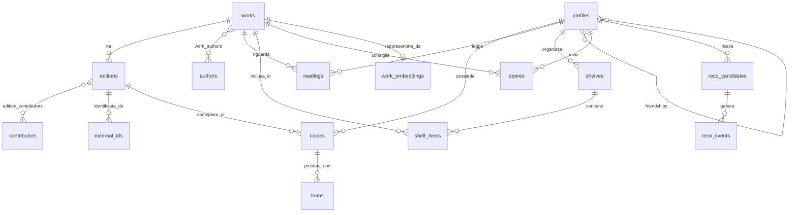

# Modello dati

Bozza del modello logico, da tradurre in migrazioni durante F1 e F2. I nomi di tabelle e colonne sono in inglese.

## Le tre idee centrali

1. **Opera, edizione, copia.** *Il nome della rosa* è un'opera; la tascabile Bompiani del 2012 è un'edizione; il volume sul tuo scaffale è una copia. Voti e consigli riguardano l'opera; ISBN e copertine l'edizione; proprietà e prestiti la copia.
2. **Possedere e leggere sono indipendenti.** `copies` e `readings` non si referenziano: un libro può stare in una, nell'altra o in entrambe.
3. **Ogni lettura è un evento.** Una riga per ogni lettura: una rilettura è una riga nuova, con le sue date e il suo voto.

## Convenzioni per poter crescere

- ID in UUID, generabili anche dal client: una futura app mobile potrà creare dati offline.
- `created_at` e `updated_at` sulle tabelle personali, utili alla sincronizzazione.
- Nessuna tabella "cerchia": le relazioni sono tra coppie di persone, quindi l'apertura al pubblico non cambia il modello.
- Lingua esplicita su edizioni e profili. L'interfaccia mostra, quando esiste, l'edizione nella lingua dell'utente.

## Catalogo condiviso

| Tabella | Colonne principali | Note |
|---|---|---|
| `works` | `id`, `title`, `original_title`, `original_language`, `first_published_year`, `description`, `merged_into` | `merged_into` permette di unire doppioni senza rompere riferimenti |
| `editions` | `id`, `work_id`, `title`, `isbn13`, `language`, `publisher`, `published_year`, `format`, `page_count`, `cover_source`, `cover_id`, `cover_path`, `metadata_status` | `isbn13` unico quando presente; molti libri vecchi non lo hanno |
| `authors` | `id`, `name`, `sort_name` | |
| `work_authors` | `work_id`, `author_id`, `position` | |
| `contributors` | `edition_id`, `name`, `role` | Traduttori e curatori: contano molto nell'editoria italiana |
| `external_ids` | `edition_id` o `work_id`, `source`, `value`, `raw` | Provenienza e payload grezzo |

Il catalogo è leggibile da tutti gli utenti autenticati, ma si modifica solo tramite azioni server validate.

## Dati personali

| Tabella | Colonne principali | Note |
|---|---|---|
| `profiles` | `id` (da `auth.users`), `handle`, `display_name`, `avatar_creature`, `locale`, `status` | `status`: `pending`, `active`, `suspended` |
| `friendships` | `user_low`, `user_high`, `status`, `requested_by`, `created_at` | Una sola riga per coppia, con vincolo `user_low < user_high` |
| `invites` | `code`, `created_by`, `expires_at`, `used_by` | Riscattare un invito attiva l'account |
| `app_settings` | `key`, `value` | Contiene `signup_mode`: `invite_only` oppure `open` |
| `copies` | `id`, `owner_id`, `edition_id`, `format`, `condition`, `location`, `is_lendable`, `acquired_at`, `visibility`, `notes` | Più copie possibili, anche della stessa edizione |
| `readings` | `id`, `user_id`, `work_id`, `edition_id?`, `status`, `started_on`, `finished_on`, `rating_half`, `review`, `visibility` | `status`: `want`, `reading`, `read`, `abandoned` |
| `shelves` | `id`, `owner_id`, `name`, `kind`, `visibility`, `position` | |
| `shelf_items` | `shelf_id`, `work_id`, `position` | |
| `wishes` | `user_id`, `work_id`, `note`, `priority`, `visibility` | Distinto da "da leggere": desidero possederlo |
| `import_jobs` | `id`, `user_id`, `source`, `status`, `total`, `done`, `report` | Import ripristinabili |
| `import_rows` | `job_id`, `raw`, `match_status`, `work_id?` | Revisione delle corrispondenze dubbie |

`rating_half` va da 1 a 10: mezzo funghetto per unità. Si evitano così i decimali nel database. Vale `NULL` quando manca il voto: un libro senza voto è diverso da un voto basso.

## Sociale

| Tabella | Colonne principali | Note |
|---|---|---|
| `loans` | `id`, `copy_id`, `borrower_id?`, `borrower_name?`, `status`, `requested_at`, `lent_on`, `due_on`, `returned_on` | Vincolo: una sola riga aperta per copia. Esattamente uno tra `borrower_id` e `borrower_name` |
| `spores` | `id`, `from_user`, `to_user`, `work_id`, `note`, `status`, `created_at` | Il segnale più forte per il recommender |
| `activity` | `id`, `actor_id`, `verb`, `object_type`, `object_id`, `visibility`, `created_at` | Feed; filtrato dalla RLS |
| `notifications` | `id`, `user_id`, `kind`, `payload`, `read_at` | |
| `blocks`, `reports` | Da progettare in F5 | Necessarie prima dell'apertura al pubblico |

## Recommender

| Tabella | Colonne principali | Note |
|---|---|---|
| `work_embeddings` | `work_id`, `model`, `embedding` | Il modello è esplicito: si possono ricalcolare senza confusione |
| `reco_candidates` | `id`, `user_id`, `work_id`, `score`, `reasons`, `sources`, `model_version`, `generated_at` | Riscritta dal batch; `reasons` è JSON strutturato, non testo libero |
| `reco_events` | `id`, `user_id`, `work_id`, `event`, `surface`, `model_version`, `created_at` | `shown`, `opened`, `saved`, `dismissed`, `started`, `finished` |

I log `reco_events` partono in F2.9, prima del modello: i dati persi non si recuperano.

## Regole di visibilità

`visibility` vale `private`, `friends` o `public`. Il default è `friends`. `public` esiste già nello schema, ma l'interfaccia lo propone solo dopo l'apertura al pubblico.

| Dato | Proprietario | Amico | Altri utenti |
|---|---|---|---|
| Copia o lettura `friends` | Vede e modifica | Vede | Non vede |
| Copia o lettura `private` | Vede e modifica | Non vede | Non vede |
| Prestito | Vede e modifica | Il beneficiario vede il proprio | Non vede |
| Spora | Mittente e destinatario | Non vede | Non vede |
| Consigli personali | Vede | Non vede | Non vede |

Regole derivate:

- "Chi ce l'ha?" mostra solo copie `friends` di amici.
- Il recommender non deve rivelare nulla di privato: un dato `private` non compare mai nelle spiegazioni e non alimenta i consigli per altri.
- L'export personale comprende tutto ciò che è dell'utente, anche i dati `private`.

## Indici

- `editions(isbn13)` univoco parziale; `editions(work_id)`.
- `copies(owner_id)`, `copies(edition_id)`.
- `readings(user_id, status)`, `readings(work_id)`.
- Ricerca testuale su titolo e autore con `pg_trgm` e `unaccent`, importante per i caratteri accentati.
- `work_embeddings` con indice HNSW quando il volume lo giustifica.
- Indici su tutte le colonne usate nelle policy RLS.
