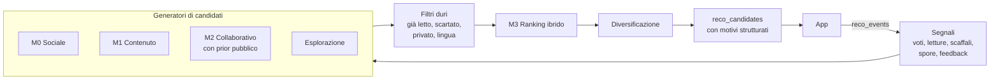

# Il Micelio: progetto del recommender

Sotto il bosco, il micelio collega i funghi e fa circolare ciò che serve. È il motore che collega i lettori e i libri.

## Il problema vero

Con pochi amici la matrice utenti-libri è minuscola e molto sparsa. Una fattorizzazione addestrata solo sui nostri dati non imparerebbe nulla di utile: il cold start è la condizione normale, non un caso limite.

In compenso abbiamo segnali che le grandi piattaforme non hanno: relazioni reali, consigli diretti, disponibilità fisica dei libri. Il sistema cresce quindi per livelli, ognuno utile da solo.



## Livelli

### M0 · Sociale, senza ML

Si può fare subito dopo F2. Candidati: libri amati dagli amici, spore ricevute, libri disponibili in prestito.

Il voto grezzo inganna: c'è chi dà 5 a tutto e chi non supera mai il 3. Serve un modello con pooling parziale:

```text
r_ui = μ + b_u + b_i + ε
b_u ~ N(0, σ_u²)    b_i ~ N(0, σ_i²)
```

Gli `b_u` correggono la generosità di ciascuno; lo shrinkage evita che un libro con un solo voto entusiasta scavalchi tutti. Si parte da stime in forma chiusa (media bayesiana), e si passa a un vero modello gerarchico solo se serve.

Affinità tra due amici: similarità sui voti residui dei libri in comune, ridotta verso zero quando i libri in comune sono pochi.

### M1 · Contenuto

Si può fare anche con un solo utente.

- Testo: titolo, autori, descrizione e soggetti dell'opera.
- Embedding multilingua: i testi sono in italiano e inglese e devono stare nello stesso spazio. Da confrontare almeno `BAAI/bge-m3` (1024 dimensioni) e un modello più leggero come `paraphrase-multilingual-MiniLM-L12-v2` (384 dimensioni), su coppie di libri scelte a mano.
- Profilo di gusto: **più centroidi** ottenuti raggruppando i libri amati. Una sola media mescola fantasy e saggi di economia in un punto che non rappresenta nessuno dei due.

Rischi: le descrizioni mancanti o molto corte; le opere senza testo vanno gestite esplicitamente, non riempite di vettori inaffidabili.

### M2 · Collaborativo con prior pubblico

Si impara la struttura tra libri su un dataset pubblico e la si applica ai nostri utenti.

- Modello item-based semplice (EASE o iALS) sul dataset esterno.
- Collegamento alle nostre opere tramite ISBN e titolo/autore normalizzati.
- *Fold-in* dei nostri utenti senza riaddestrare sui loro dati.

| Dataset | Contenuto | Vincoli |
|---|---|---|
| goodbooks-10k | ~6 milioni di voti, 10.000 libri, tag, to-read | Controllare il `LICENSE` della repo prima dell'uso; molto sbilanciato su bestseller in inglese |
| UCSD Book Graph | 2,36 milioni di libri, 228 milioni di interazioni | **Solo uso accademico, niente redistribuzione**: non va usato per il prodotto |

Limite noto: i libri italiani non tradotti saranno poco coperti. M1 resta quindi essenziale.

### M3 · Ranking ibrido

Parti da un punteggio lineare leggibile:

```text
score = w₁·sociale + w₂·contenuto + w₃·collaborativo + w₄·disponibile_in_prestito + w₅·novità
```

Pesi scelti a mano all'inizio. Solo quando `reco_events` conterrà abbastanza dati, stimali con una regressione logistica su salvato/scartato.

Poi:

- **Diversità**: MMR e limite di libri per autore.
- **Esplorazione**: una posizione fissa per un "fungo raro", scelta con Thompson sampling su priori Beta.
- **Modalità speciali**: "Regalo per Sara" (esclude i suoi libri), "Per il club" (intersezione dei gusti), "Posso farmelo prestare".

## Spiegazioni

Ogni consiglio deve avere almeno un motivo. `reasons` è JSON strutturato e il testo si compone nella UI:

```json
[
  {"type": "friend_loved", "friend_id": "...", "rating_half": 9},
  {"type": "similar_to", "work_id": "...", "similarity": 0.81},
  {"type": "available_from", "friend_id": "..."}
]
```

"Marta, che ha gusti simili ai tuoi, l'ha adorato · è nella Tana di Luca". Un candidato senza spiegazione valida non si mostra.

## Valutazione

**Offline**

- Split temporale: si tiene fuori l'ultima interazione positiva di ciascun utente.
- Metriche: Recall@10, nDCG@10, copertura del catalogo, diversità interna alla lista.
- Baseline obbligatorie: libri più amati dalla cerchia, e popolarità globale per M2.
- Con pochi utenti le metriche sono rumorose: riporta sempre gli intervalli (bootstrap) e non decidere sul decimale. Usa il dataset pubblico per validare la meccanica del modello, non la sua utilità per noi.

**Online**

- Quanti consigli vengono salvati, scartati, iniziati e finiti.
- Domanda diretta periodica agli amici: quale consiglio ti ha sorpreso?
- Con pochi utenti l'A/B test non ha potenza: preferisci confronti interni allo stesso elenco e feedback qualitativo.

## Architettura operativa

- Job notturno su GitHub Actions; l'app legge solo `reco_candidates`, quindi resta veloce e il worker è sostituibile.
- `model_version` su ogni riga e su ogni evento, per poter confrontare le versioni.
- Il ruolo database del worker legge solo i segnali necessari e scrive solo nelle tabelle del recommender.
- La repo è pubblica: i log del job non devono contenere titoli, nomi o ID utente.
- Modelli e artefatti non stanno in git.

## Regole di privacy

- I dati `private` restano fuori dai segnali usati per altri utenti.
- Una spiegazione può citare solo fatti che l'utente potrebbe già vedere.
- Ogni utente può disattivare l'uso dei propri dati nei consigli degli amici.

## Fonti

- [goodbooks-10k](https://github.com/zygmuntz/goodbooks-10k)
- [UCSD Book Graph](https://mcauleylab.ucsd.edu/public_datasets/gdrive/goodreads/UCSD%20Book%20Graph.html)
