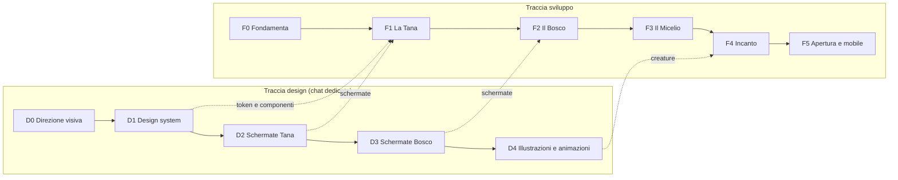

# Roadmap di Libresca

Questo file è la **fonte di verità sullo stato del progetto**. Va aggiornato alla fine di ogni task: spunta le caselle e, se un piano cambia, riscrivilo invece di aggiungere note a margine.

**Stato attuale:** fondamenta documentali pronte, decisioni iniziali prese, direzione visiva e design system scelti (D0, D1), fonti dei metadati misurate (F0.2, ADR-0008), monorepo pronto con una pagina che usa token, font e testi tradotti (F0.3), Supabase locale in Docker e progetto remoto a Francoforte con tipi generati (F0.4). CI su GitHub Actions con controlli, test RLS ed e2e (F0.5), deploy su `libresca.vercel.app` con preview per PR e Stop hook sul typecheck (F0.6). Login con Google, accesso riservato agli account attivi e shell PWA installabile (F0.7). Job giornaliero che tiene attivo Supabase (F0.8): **F0 è chiusa**. Catalogo condiviso con scrittura validata e ricerca senza accenti (F1.1). API che propone la scheda di un libro per ISBN dalle tre fonti (F1.2a) e ricerca per titolo e autore che segnala le opere già nel catalogo (F1.2b): **F1.2 è chiusa**. Prima schermata per aggiungere un libro: ricerca unica per titolo, autore o ISBN, scheda da confermare e correggere, scheda libro essenziale (F1.3a). Prossimo task: **F1.3b**, inserimento da zero con foto della copertina; sulla traccia design, **D2**.

Dimensioni indicative dei task: **S** (una sessione), **M** (qualche sessione), **L** (da spezzare prima di iniziare).

## Schema generale

| | F0 Fondamenta | F1 La Tana | F2 Il Bosco | F3 Il Micelio | F4 Incanto |
|---|---|---|---|---|---|
| **Obiettivo** | Si può costruire | Funziona per me | Funziona con gli amici | Mi consiglia bene | Fa innamorare |
| **UI** | Shell PWA | Libreria, scheda libro, scanner | Tane amici, prestiti, spore | Pagina consigli con "perché" | Creature, micro-animazioni |
| **Backend** | Repo, pacchetti condivisi, Supabase, CI, deploy | Catalogo, copie, letture, scaffali | Amicizie, permessi, feed | Tabelle consigli e feedback | Notifiche push, offline |
| **Dati** | Test fonti metadati | Import Goodreads, export | Inviti, seed amici | Embedding, dataset pubblici | Statistiche annuali |
| **Recommender** | | Raccolta segnali | Log impression, consigli sociali | Contenuto, collaborativo, ibrido | Tuning con feedback reali |

## Decisioni

| # | Tema | Decisione | Effetto sul progetto |
|---|---|---|---|
| 1 | Accesso | Su invito all'inizio, progettata per aprirsi al pubblico | L'accesso è un'impostazione, non una regola scritta nel codice |
| 2 | Piattaforma | Web app ora, app mobile in futuro | Logica in pacchetti condivisi e API riusabili fuori dal browser |
| 3 | Costi | 0 € finché resta privata, piccola spesa quando si apre | Login Google, job anti-pausa, nessun dominio né servizio email |
| 4 | Import | Goodreads | Voti e date di fine si importano; le date di inizio non sono nell'export (vedi F1.8) |
| 5 | Licenza | MIT per il codice, nome e illustrazioni riservati | Nessun conflitto con l'App Store, dipendenze permissive |
| 6 | Lingue | Italiano ora, altre lingue in futuro | Sistema di traduzione attivo da subito |
| 7 | Embedding | Modello open eseguito nel job notturno | Nessun costo per chiamata e nessun servizio esterno |
| 8 | Fonti metadati | Google Books, Open Library e SBN interrogati in parallelo, uniti campo per campo | Google Books trova i libri ma non entra nel catalogo come copia permanente; SBN dà pagine e traduttori italiani |

Dettagli in [ADR-0005](adr/0005-portabilita-mobile-e-pubblico.md), [ADR-0006](adr/0006-accesso-a-costo-zero.md), [ADR-0007](adr/0007-licenza.md) e [ADR-0008](adr/0008-cascata-fonti-metadati.md).

## F0 · Fondamenta

*Fatto quando:* una pagina con login è online in HTTPS, la CI è verde e la scelta delle fonti metadati si basa su numeri reali.

- [x] **F0.1** (S) Prendere le decisioni iniziali e aggiungere la licenza
- [x] **F0.2** (S) Spike metadati: misurata la copertura di 49 ISBN del tuo export Goodreads (35 italiani) su Open Library, Google Books e SBN; risultati e ordine delle fonti nell'ADR-0008
- [x] **F0.3** (M) Scaffold del monorepo: pnpm, Next.js, TypeScript strict, Tailwind con tema generato dai token, next-intl, ESLint e Prettier, Vitest, Playwright su mobile e desktop; pacchetti `domain` (con normalizzazione ISBN), `data`, `i18n`, `tokens`; comandi in `CLAUDE.md`
- [x] **F0.4** (S) Supabase locale e progetto remoto in regione UE (`eu-central-1`), generazione dei tipi in `packages/data`, client tipizzato, test pgTAP che blocca le tabelle senza RLS
- [x] **F0.5** (S) CI su GitHub Actions: typecheck, lint, test, test RLS; in più e2e su mobile e desktop e controllo che i tipi generati siano aggiornati
- [x] **F0.6** (S) Deploy con preview su Vercel (`libresca.vercel.app`, preview e produzione sullo stesso progetto Supabase); Stop hook di Claude Code che richiede il typecheck
- [x] **F0.7** (M) Login con Google, accesso riservato agli account attivi, shell PWA; diviso in due PR
  - [x] **F0.7a** Login con Google, `profiles` e `app_settings` con RLS, regola di accesso in `packages/domain`, `proxy.ts`, pagine di login e attesa, e2e con account finti sullo stack locale
  - [x] **F0.7b** Shell PWA: manifest dai token, icone provvisorie generate dalla topina segnaposto (`pnpm icons`), colore della barra per giorno e notte; nessun service worker, l'offline è F4.3
- [x] **F0.8** (S) Job giornaliero su GitHub Actions che tiene attivo Supabase con una vera lettura (`public.health_check()`) e, se il controllo fallisce, apre una issue

## F1 · La Tana

*Fatto quando:* la tua libreria reale è dentro, e per due settimane usi Libresca al posto di Goodreads.

- [x] **F1.1** (M) Catalogo: opere, edizioni, autori con nomi alternativi, contributori, ID esterni. Lettura per i soli account attivi; scrittura solo con `public.create_edition()`, validata prima da `validateCatalogEntry` in `packages/domain`; ricerca `public.search_works()` con `pg_trgm` e `unaccent`; letture e scrittura in `packages/data`
- [x] **F1.2** (M) API metadati in `/api/v1`: fonti in parallelo e unione per campo secondo l'ADR-0008; diviso in due PR
  - [x] **F1.2a** Ricerca per ISBN: `GET /api/v1/books/isbn/{isbn}` con cookie o Bearer, prima il catalogo e poi Open Library, Google Books e SBN in parallelo; proposta con la fonte di ogni campo, senza salvare; nuovo pacchetto `packages/metadata` con parser, unione, ritmo per fonte, cache in memoria e `proposalToCatalogEntry`; quota Google Books misurata (1.000 al giorno, 100 al minuto per utente)
  - [x] **F1.2b** Ricerca per titolo e autore: `GET /api/v1/books/search?q=` con testo libero; catalogo, Open Library e Google Books in parallelo (SBN no); risultati raggruppati per opera con le edizioni trovate; ogni candidato già nel catalogo lo segnala, certo per ID condiviso o probabile per titolo e autore, senza unire nulla da solo; testi delle fonti normalizzati in NFC
- [ ] **F1.3** (M) Aggiunta libro: ricerca per titolo/autore, ISBN, inserimento manuale comodo anche con foto della copertina, perché le novità sono il punto debole delle fonti; diviso in due PR
  - [x] **F1.3a** Cercare, scegliere e confermare: `/add` con una sola casella che riconosce l'ISBN (`parseBookQuery`), risultati con le opere già nel catalogo e i candidati delle fonti, scelta dell'edizione, scheda con i campi correggibili (le correzioni hanno fonte `user`), aggancio all'opera esistente (certo per ID condiviso, con domanda per titolo e autore), autori riusati per ID Open Library, scheda libro essenziale `/books/{id}`; un ISBN sconosciuto apre la scheda vuota con il codice. Senza il disegno della D2: si usano token e componenti di D1
  - [ ] **F1.3b** Inserimento da zero comodo e foto della copertina: bucket Storage con policy e test, foto ridotta nel browser, `cover_source = 'upload'`
- [ ] **F1.4** (M) Scanner barcode da fotocamera, testato anche su iPhone
- [ ] **F1.5** (M) Copie possedute: formato, posizione, condizioni, prestabile sì/no
- [ ] **F1.6** (M) Letture: stati, date, riletture, voto a funghetti, note
- [ ] **F1.7** (M) Tana e scheda libro: griglia, scaffali, filtri, ricerca interna
- [ ] **F1.8** (M) Import Goodreads con revisione delle corrispondenze dubbie e completamento guidato delle date mancanti; scegliere qui come recuperare le date di inizio. Serve una cache condivisa delle fonti aperte su Postgres, e Google Books solo per i buchi, per non esaurire la quota giornaliera
- [ ] **F1.9** (S) Export completo CSV/JSON
- [ ] **F1.10** (S) Copertina generata per i libri senza immagine, foto copertina facoltativa

## F2 · Il Bosco

*Fatto quando:* almeno 5 amici hanno una Tana attiva e tutte le tabelle hanno test RLS.

- [ ] **F2.1** (M) Attivazione tramite invito, richieste di amicizia, profilo
- [ ] **F2.2** (M) Visibilità per copia e lettura, suite di test RLS sugli scenari tra amici
- [ ] **F2.3** (S) Tana degli amici in sola lettura
- [ ] **F2.4** (S) "Chi ce l'ha?" su scheda libro e ricerca
- [ ] **F2.5** (M) Prestiti: richiesta, accettazione, consegna, promemoria, restituzione; anche verso chi non è nell'app
- [ ] **F2.6** (M) Spore: consigli diretti con nota e stato (ricevuta, in lista, letta, grazie)
- [ ] **F2.7** (S) Lista dei desideri e "idee regalo" per un amico
- [ ] **F2.8** (M) Feed del Bosco e notifiche in app; quelle email richiedono un servizio SMTP e aspettano la F5
- [ ] **F2.9** (S) Log delle interazioni per il recommender: impression, salvataggi, scarti
- [ ] **F2.10** (S) Cancellazione effettiva dell'account e dei relativi dati

## F3 · Il Micelio

*Fatto quando:* il modello batte le baseline offline e gli amici salvano davvero i consigli. Dettagli in `docs/RECOMMENDER.md`.

- [ ] **F3.1** (S) Livello M0: consigli sociali, senza ML, con spiegazioni
- [ ] **F3.2** (M) Ambiente `ml/`, job notturno, ruolo database dedicato, tabelle consigli
- [ ] **F3.3** (M) Livello M1: embedding multilingua e profili di gusto
- [ ] **F3.4** (M) Harness di valutazione offline con baseline
- [ ] **F3.5** (M) Livello M2: prior collaborativo da dataset pubblico, dopo verifica della licenza
- [ ] **F3.6** (M) Livello M3: ranking ibrido, diversificazione, esplorazione
- [ ] **F3.7** (M) Pagina consigli con "perché", "non mi interessa" e modalità regalo

## F4 · Incanto

*Fatto quando:* gli amici fanno vedere l'app ad altri senza che glielo chieda.

- [ ] **F4.1** (L) Integrare creature, illustrazioni e animazioni della D4
- [ ] **F4.2** (M) Statistiche e riepilogo annuale
- [ ] **F4.3** (M) Modalità offline per consultare la Tana in libreria
- [ ] **F4.4** (S) Notifiche push
- [ ] **F4.5** (M) Audit di accessibilità e prestazioni su telefoni economici

## F5 · Apertura e app mobile

Si valuta solo dopo un uso reale. Le due strade sono indipendenti. Qui i piccoli costi sono previsti.

### App mobile

- [ ] **F5.1** (L) `apps/mobile` in Expo, riusando `domain`, `data`, `i18n` e `tokens`
- [ ] **F5.2** (M) Scanner nativo, sessione sicura sul dispositivo, deep link
- [ ] **F5.3** (S) Requisiti App Store: alternativa di login equivalente a Google, cancellazione account dall'app, segnalazione e blocco degli utenti

### Apertura al pubblico

- [ ] **F5.4** (M) Blocco utenti, segnalazioni, moderazione di recensioni e modifiche al catalogo
- [ ] **F5.5** (S) Termini d'uso e informativa privacy, con revisione legale
- [ ] **F5.6** (M) Dominio e SMTP: email transazionali, login via email, notifiche
- [ ] **F5.7** (M) Passaggio a Supabase Pro; Vercel Pro in caso di entrate o pubblicità
- [ ] **F5.8** (M) Catalogo locale alimentato dai dump di Open Library, per reggere il traffico
- [ ] **F5.9** (M) Test di carico su policy RLS e job del recommender
- [ ] **F5.10** (S) Impostare `signup_mode` su `open`

### Altre lingue

- [ ] **F5.11** (M) Selettore lingua, traduzione dei testi e adattamento del vocabolario del sottobosco

### Idee da rivalutare

- Club di lettura tra amici
- Tag di mood e ritmo arricchiti da LLM
- Federazione con ActivityPub

## Traccia design

Si lavora nella chat di design del progetto Claude, a partire da `docs/design/DESIGN_BRIEF.md`.

- [x] **D0** Direzione visiva: scelta la direzione D "Sottobosco" tra quattro proposte (Erbario, Lanterna, Linoleum, Sottobosco), con giorno e notte su cinque schermate. Logo e mascotte definitiva passano alla D4
- [x] **D1** Design system: token in `packages/tokens/tokens.json` con CSS generato e test, regole in `docs/design/DESIGN_SYSTEM.md`, icone e motivi in `docs/design/assets/`
- [ ] **D2** Schermate Tana: libreria, scheda libro, scanner, aggiunta, stati vuoti
- [ ] **D3** Schermate Bosco: tane degli amici, prestiti, spore, consigli
- [ ] **D4** Set di creature, illustrazioni e animazioni; mascotte definitiva (sostituisce la topina provvisoria) e logo

F0 non dipende dal design. Da F0.3 in poi la UI usa i token di `packages/tokens`; le schermate di F1 possono partire anche se D2 è ancora in corso.

## Registro dei cambi di piano

| Data | Cambiamento | Motivo |
|---|---|---|
| 2026-11-05 | Prima versione | Avvio del progetto |
| 2026-11-05 | Scelti import Goodreads e licenza MIT; F0.2 usa gli ISBN dell'export | Decisioni dell'utente in F0.1 |
| 2026-11-05 | Accesso su invito ma apribile, API riusabili da mobile, i18n da subito, login Google, nuova F5 | Decisioni dell'utente in F0.1 |
| 2026-11-05 | Chiuse D0 e D1: direzione "Sottobosco", token e design system in repo; logo e mascotte spostati in D4 | Scelta dell'utente nella chat di design |
| 2026-11-07 | Chiusa F0.3: TypeScript 6.0 ed ESLint 9 al posto delle ultime versioni, per compatibilità dei plugin | Vincoli di typescript-eslint e `eslint-config-next` |
| 2026-11-07 | Chiusa F0.2: fonti in parallelo invece della cascata, Google Books senza copie permanenti, SBN per gli ISBN italiani; F1.1, F1.2 e F1.3 aggiornate | Numeri dello spike (ADR-0008) e termini d'uso di Google |
| 2026-11-07 | Chiusa F0.4: CLI Supabase come devDependency, edge functions e analytics spente in locale, schema `private` per le funzioni delle policy | Lo stack non usa edge functions (ADR-0001); helper delle policy fuori dall'API |
| 2026-11-07 | Chiusa F0.6: preview Vercel sullo stesso progetto Supabase della produzione | Database ancora vuoto; il secondo progetto gratuito resta per uno staging |
| 2026-11-07 | F0.7 da S a M e divisa in F0.7a (login e accesso) e F0.7b (PWA); il primo account si attiva con `private.activate_profile(email)` dal SQL Editor | Il task conteneva auth, due tabelle e la PWA; gli inviti arrivano solo in F2 |
| 2026-11-08 | Chiusa F1.1: il catalogo si scrive solo con una funzione `security definer` (niente scritture dirette né chiave service role sui client); ricerca testuale anticipata da F1.3; `external_ids` anche sugli autori; in più `field_sources`, `created_by` e `merged_into` sugli autori | Decisioni dell'utente all'avvio di F1.1; la provenienza per campo serve all'ADR-0008 |
| 2026-11-08 | F1.2 divisa in F1.2a (ISBN) e F1.2b (titolo e autore); logica delle fonti in un nuovo pacchetto `packages/metadata`; la cache condivisa passa da F1.2 a F1.8, in F1.2 solo cache in memoria | Lo scanner (F1.4) ha bisogno solo dell'ISBN; una cache condivisa a costo zero vale la pena solo con i volumi dell'import |
| 2026-11-08 | Chiusa F1.2b: la ricerca per titolo non interroga SBN; risultati per opera, con Google Books agganciato a Open Library solo tramite ISBN | Decisioni dell'utente all'avvio di F1.2b; il ritmo di SBN serve alla ricerca per ISBN |
| 2026-11-08 | F1.3 divisa in F1.3a (ricerca, scelta e conferma) e F1.3b (inserimento da zero e foto, con Storage); le schermate partono senza la D2; finché non ci sono le copie (F1.5) aggiungere vuol dire mettere il libro nel catalogo comune | Decisioni dell'utente all'avvio di F1.3; la migrazione dello Storage resta in una PR a parte |
