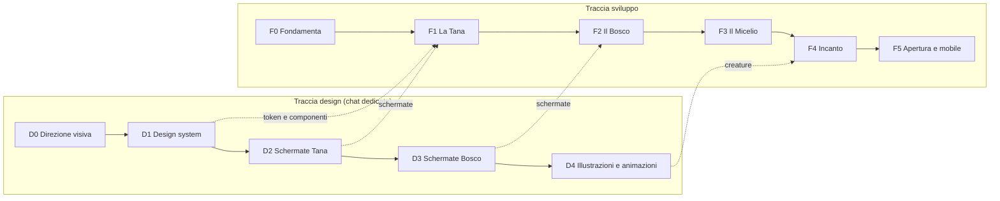

# Roadmap di Libresca

Questo file è la **fonte di verità sullo stato del progetto**. Va aggiornato alla fine di ogni task: spunta le caselle e, se un piano cambia, riscrivilo invece di aggiungere note a margine.

**Stato attuale:** fondamenta documentali pronte, tutte le decisioni iniziali prese, direzione visiva e design system scelti (D0, D1), nessun codice applicativo. Prossimo task: **F0.2**, che richiede l'export Goodreads da scaricare sul tuo PC; sulla traccia design, **D2**.

Dimensioni indicative dei task: **S** (una sessione), **M** (qualche sessione), **L** (da spezzare prima di iniziare).

## Schema generale

| | F0 Fondamenta | F1 La Tana | F2 Il Bosco | F3 Il Micelio | F4 Incanto |
|---|---|---|---|---|---|
| **Obiettivo** | Si può costruire | Funziona per me | Funziona con gli amici | Mi consiglia bene | Fa innamorare |
| **UI** | Shell PWA | Libreria, scheda libro, scanner | Tane amici, prestiti, spore | Pagina consigli con "perché" | Creature, micro-animazioni |
| **Backend** | Repo, pacchetti condivisi, Supabase, CI, deploy | Catalogo, copie, letture, scaffali | Amicizie, permessi, feed | Tabelle consigli e feedback | Notifiche push, offline |
| **Dati** | Test fonti metadati | Import Goodreads, export | Inviti, seed amici | Embedding, dataset pubblici | Statistiche annuali |
| **Recommender** | | Raccolta segnali | Log impression, consigli sociali | Contenuto, collaborativo, ibrido | Tuning con feedback reali |

## Decisioni

| # | Tema | Decisione | Effetto sul progetto |
|---|---|---|---|
| 1 | Accesso | Su invito all'inizio, progettata per aprirsi al pubblico | L'accesso è un'impostazione, non una regola scritta nel codice |
| 2 | Piattaforma | Web app ora, app mobile in futuro | Logica in pacchetti condivisi e API riusabili fuori dal browser |
| 3 | Costi | 0 € finché resta privata, piccola spesa quando si apre | Login Google, job anti-pausa, nessun dominio né servizio email |
| 4 | Import | Goodreads | Voti e date di fine si importano; le date di inizio non sono nell'export (vedi F1.8) |
| 5 | Licenza | MIT per il codice, nome e illustrazioni riservati | Nessun conflitto con l'App Store, dipendenze permissive |
| 6 | Lingue | Italiano ora, altre lingue in futuro | Sistema di traduzione attivo da subito |
| 7 | Embedding | Modello open eseguito nel job notturno | Nessun costo per chiamata e nessun servizio esterno |

Dettagli in [ADR-0005](adr/0005-portabilita-mobile-e-pubblico.md), [ADR-0006](adr/0006-accesso-a-costo-zero.md) e [ADR-0007](adr/0007-licenza.md).

## F0 · Fondamenta

*Fatto quando:* una pagina con login è online in HTTPS, la CI è verde e la scelta delle fonti metadati si basa su numeri reali.

- [x] **F0.1** (S) Prendere le decisioni iniziali e aggiungere la licenza
- [ ] **F0.2** (S) Spike metadati: misurare la copertura di 50 ISBN presi dal tuo export Goodreads, soprattutto italiani, su Open Library, Google Books e SBN (metodo in `docs/ARCHITECTURE.md`)
- [ ] **F0.3** (M) Scaffold del monorepo: pnpm, Next.js, TypeScript strict, Tailwind, next-intl, lint, Vitest, Playwright; pacchetti `domain`, `data`, `i18n`, `tokens`; aggiornare i comandi in `CLAUDE.md`
- [ ] **F0.4** (S) Supabase locale e progetto remoto in regione UE, generazione dei tipi
- [ ] **F0.5** (S) CI su GitHub Actions: typecheck, lint, test, test RLS
- [ ] **F0.6** (S) Deploy con preview su Vercel; Stop hook di Claude Code che richiede il typecheck
- [ ] **F0.7** (S) Login con Google, accesso riservato agli account attivi, shell PWA (manifest, icone provvisorie)
- [ ] **F0.8** (S) Job giornaliero su GitHub Actions che tiene attivo Supabase e segnala se il controllo fallisce

## F1 · La Tana

*Fatto quando:* la tua libreria reale è dentro, e per due settimane usi Libresca al posto di Goodreads.

- [ ] **F1.1** (M) Catalogo: opere, edizioni, autori, contributori, ID esterni
- [ ] **F1.2** (M) API metadati in `/api/v1`: cascata di fonti, cache, normalizzazione ISBN, deduplica
- [ ] **F1.3** (M) Aggiunta libro: ricerca per titolo/autore, ISBN, inserimento manuale
- [ ] **F1.4** (M) Scanner barcode da fotocamera, testato anche su iPhone
- [ ] **F1.5** (M) Copie possedute: formato, posizione, condizioni, prestabile sì/no
- [ ] **F1.6** (M) Letture: stati, date, riletture, voto a funghetti, note
- [ ] **F1.7** (M) Tana e scheda libro: griglia, scaffali, filtri, ricerca interna
- [ ] **F1.8** (M) Import Goodreads con revisione delle corrispondenze dubbie e completamento guidato delle date mancanti; scegliere qui come recuperare le date di inizio
- [ ] **F1.9** (S) Export completo CSV/JSON
- [ ] **F1.10** (S) Copertina generata per i libri senza immagine, foto copertina facoltativa

## F2 · Il Bosco

*Fatto quando:* almeno 5 amici hanno una Tana attiva e tutte le tabelle hanno test RLS.

- [ ] **F2.1** (M) Attivazione tramite invito, richieste di amicizia, profilo
- [ ] **F2.2** (M) Visibilità per copia e lettura, suite di test RLS sugli scenari tra amici
- [ ] **F2.3** (S) Tana degli amici in sola lettura
- [ ] **F2.4** (S) "Chi ce l'ha?" su scheda libro e ricerca
- [ ] **F2.5** (M) Prestiti: richiesta, accettazione, consegna, promemoria, restituzione; anche verso chi non è nell'app
- [ ] **F2.6** (M) Spore: consigli diretti con nota e stato (ricevuta, in lista, letta, grazie)
- [ ] **F2.7** (S) Lista dei desideri e "idee regalo" per un amico
- [ ] **F2.8** (M) Feed del Bosco e notifiche in app; quelle email richiedono un servizio SMTP e aspettano la F5
- [ ] **F2.9** (S) Log delle interazioni per il recommender: impression, salvataggi, scarti
- [ ] **F2.10** (S) Cancellazione effettiva dell'account e dei relativi dati

## F3 · Il Micelio

*Fatto quando:* il modello batte le baseline offline e gli amici salvano davvero i consigli. Dettagli in `docs/RECOMMENDER.md`.

- [ ] **F3.1** (S) Livello M0: consigli sociali, senza ML, con spiegazioni
- [ ] **F3.2** (M) Ambiente `ml/`, job notturno, ruolo database dedicato, tabelle consigli
- [ ] **F3.3** (M) Livello M1: embedding multilingua e profili di gusto
- [ ] **F3.4** (M) Harness di valutazione offline con baseline
- [ ] **F3.5** (M) Livello M2: prior collaborativo da dataset pubblico, dopo verifica della licenza
- [ ] **F3.6** (M) Livello M3: ranking ibrido, diversificazione, esplorazione
- [ ] **F3.7** (M) Pagina consigli con "perché", "non mi interessa" e modalità regalo

## F4 · Incanto

*Fatto quando:* gli amici fanno vedere l'app ad altri senza che glielo chieda.

- [ ] **F4.1** (L) Integrare creature, illustrazioni e animazioni della D4
- [ ] **F4.2** (M) Statistiche e riepilogo annuale
- [ ] **F4.3** (M) Modalità offline per consultare la Tana in libreria
- [ ] **F4.4** (S) Notifiche push
- [ ] **F4.5** (M) Audit di accessibilità e prestazioni su telefoni economici

## F5 · Apertura e app mobile

Si valuta solo dopo un uso reale. Le due strade sono indipendenti. Qui i piccoli costi sono previsti.

### App mobile

- [ ] **F5.1** (L) `apps/mobile` in Expo, riusando `domain`, `data`, `i18n` e `tokens`
- [ ] **F5.2** (M) Scanner nativo, sessione sicura sul dispositivo, deep link
- [ ] **F5.3** (S) Requisiti App Store: alternativa di login equivalente a Google, cancellazione account dall'app, segnalazione e blocco degli utenti

### Apertura al pubblico

- [ ] **F5.4** (M) Blocco utenti, segnalazioni, moderazione di recensioni e modifiche al catalogo
- [ ] **F5.5** (S) Termini d'uso e informativa privacy, con revisione legale
- [ ] **F5.6** (M) Dominio e SMTP: email transazionali, login via email, notifiche
- [ ] **F5.7** (M) Passaggio a Supabase Pro; Vercel Pro in caso di entrate o pubblicità
- [ ] **F5.8** (M) Catalogo locale alimentato dai dump di Open Library, per reggere il traffico
- [ ] **F5.9** (M) Test di carico su policy RLS e job del recommender
- [ ] **F5.10** (S) Impostare `signup_mode` su `open`

### Altre lingue

- [ ] **F5.11** (M) Selettore lingua, traduzione dei testi e adattamento del vocabolario del sottobosco

### Idee da rivalutare

- Club di lettura tra amici
- Tag di mood e ritmo arricchiti da LLM
- Federazione con ActivityPub

## Traccia design

Si lavora nella chat di design del progetto Claude, a partire da `docs/design/DESIGN_BRIEF.md`.

- [x] **D0** Direzione visiva: scelta la direzione D "Sottobosco" tra quattro proposte (Erbario, Lanterna, Linoleum, Sottobosco), con giorno e notte su cinque schermate. Logo e mascotte definitiva passano alla D4
- [x] **D1** Design system: token in `packages/tokens/tokens.json` con CSS generato e test, regole in `docs/design/DESIGN_SYSTEM.md`, icone e motivi in `docs/design/assets/`
- [ ] **D2** Schermate Tana: libreria, scheda libro, scanner, aggiunta, stati vuoti
- [ ] **D3** Schermate Bosco: tane degli amici, prestiti, spore, consigli
- [ ] **D4** Set di creature, illustrazioni e animazioni; mascotte definitiva (sostituisce la topina provvisoria) e logo

F0 non dipende dal design. Da F0.3 in poi la UI usa i token di `packages/tokens`; le schermate di F1 possono partire anche se D2 è ancora in corso.

## Registro dei cambi di piano

| Data | Cambiamento | Motivo |
|---|---|---|
| 2026-11-05 | Prima versione | Avvio del progetto |
| 2026-11-05 | Scelti import Goodreads e licenza MIT; F0.2 usa gli ISBN dell'export | Decisioni dell'utente in F0.1 |
| 2026-11-05 | Accesso su invito ma apribile, API riusabili da mobile, i18n da subito, login Google, nuova F5 | Decisioni dell'utente in F0.1 |
| 2026-11-05 | Chiuse D0 e D1: direzione "Sottobosco", token e design system in repo; logo e mascotte spostati in D4 | Scelta dell'utente nella chat di design |
