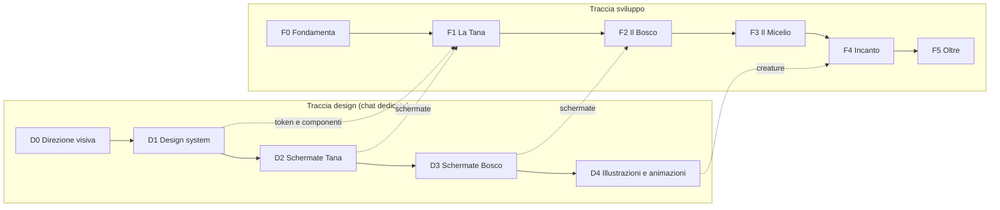

# Roadmap di Libresca

Questo file è la **fonte di verità sullo stato del progetto**. Va aggiornato alla fine di ogni task: spunta le caselle e, se un piano cambia, riscrivilo invece di aggiungere note a margine.

**Stato attuale:** fondamenta documentali pronte, nessun codice. Prossimo task: **F0.1**.

Dimensioni indicative dei task: **S** (una sessione), **M** (qualche sessione), **L** (da spezzare prima di iniziare).

## Schema generale

| | F0 Fondamenta | F1 La Tana | F2 Il Bosco | F3 Il Micelio | F4 Incanto |
|---|---|---|---|---|---|
| **Obiettivo** | Si può costruire | Funziona per me | Funziona con gli amici | Mi consiglia bene | Fa innamorare |
| **UI** | Shell PWA | Libreria, scheda libro, scanner | Tane amici, prestiti, spore | Pagina consigli con "perché" | Creature, micro-animazioni |
| **Backend** | Repo, Supabase, CI, deploy | Catalogo, copie, letture, scaffali | Amicizie, permessi, feed | Tabelle consigli e feedback | Notifiche push, offline |
| **Dati** | Test fonti metadati | Import Goodreads, export | Inviti, seed amici | Embedding, dataset pubblici | Statistiche annuali |
| **Recommender** | | Raccolta segnali | Log impression, consigli sociali | Contenuto, collaborativo, ibrido | Tuning con feedback reali |

## Decisioni aperte

La colonna "Ipotesi" indica ciò che la documentazione dà per buono. Vanno confermate o cambiate in **F0.1**.

| # | Decisione | Ipotesi attuale | Se cambia |
|---|---|---|---|
| 1 | Chi può entrare? | Cerchia chiusa, solo su invito | Privacy, moderazione e costi diventano molto più impegnativi |
| 2 | Web o app nativa? | PWA mobile-first | Valutare Expo e rifare l'ADR-0001 |
| 3 | Budget mensile | 0 €, con possibile passaggio a Supabase Pro (25 $/mese) | Con 0 € rigidi, il progetto va in pausa dopo una settimana di inattività |
| 4 | Da dove importare? | Goodreads CSV | Aggiungere Anobii o StoryGraph in F1.8 |
| 5 | Licenza della repo | Nessuna (repo pubblica, tutti i diritti riservati) | Scegliere una licenza open source e aggiungere `LICENSE` |
| 6 | Lingua dell'app | Solo italiano, testi già centralizzati | Con più lingue, attivare l'i18n prima di F1 |
| 7 | Embedding | Modello open eseguito nel job batch | Con un'API esterna si aggiungono costi e invio dati a terzi |

## F0 · Fondamenta

*Fatto quando:* una pagina con login è online in HTTPS, la CI è verde e la scelta delle fonti metadati si basa su numeri reali.

- [ ] **F0.1** (S) Rivedere le decisioni aperte e portare gli ADR da "Proposta" ad "Accettata"
- [ ] **F0.2** (S) Spike metadati: misurare la copertura di 50 ISBN reali della tua libreria, soprattutto italiani, su Open Library, Google Books e SBN (metodo in `docs/ARCHITECTURE.md`)
- [ ] **F0.3** (M) Scaffold del monorepo: pnpm, Next.js, TypeScript strict, Tailwind, lint, Vitest, Playwright; aggiornare i comandi in `CLAUDE.md`
- [ ] **F0.4** (S) Supabase locale e progetto remoto in regione UE, generazione dei tipi
- [ ] **F0.5** (S) CI su GitHub Actions: typecheck, lint, test, test RLS
- [ ] **F0.6** (S) Deploy con preview su Vercel; Stop hook di Claude Code che richiede il typecheck
- [ ] **F0.7** (S) Login via email con magic link e shell PWA (manifest, icone provvisorie)

## F1 · La Tana

*Fatto quando:* la tua libreria reale è dentro, e per due settimane usi Libresca al posto di Goodreads.

- [ ] **F1.1** (M) Catalogo: opere, edizioni, autori, contributori, ID esterni
- [ ] **F1.2** (M) Servizio metadati: cascata di fonti, cache, normalizzazione ISBN, deduplica
- [ ] **F1.3** (M) Aggiunta libro: ricerca per titolo/autore, ISBN, inserimento manuale
- [ ] **F1.4** (M) Scanner barcode da fotocamera, testato anche su iPhone
- [ ] **F1.5** (M) Copie possedute: formato, posizione, condizioni, prestabile sì/no
- [ ] **F1.6** (M) Letture: stati, date, riletture, voto a funghetti, note
- [ ] **F1.7** (M) Tana e scheda libro: griglia, scaffali, filtri, ricerca interna
- [ ] **F1.8** (M) Import Goodreads con revisione delle corrispondenze dubbie
- [ ] **F1.9** (S) Export completo CSV/JSON
- [ ] **F1.10** (S) Copertina generata per i libri senza immagine, foto copertina facoltativa

## F2 · Il Bosco

*Fatto quando:* almeno 5 amici hanno una Tana attiva e tutte le tabelle hanno test RLS.

- [ ] **F2.1** (M) Inviti via link, richieste di amicizia, profilo
- [ ] **F2.2** (M) Visibilità per copia e lettura, suite di test RLS sugli scenari tra amici
- [ ] **F2.3** (S) Tana degli amici in sola lettura
- [ ] **F2.4** (S) "Chi ce l'ha?" su scheda libro e ricerca
- [ ] **F2.5** (M) Prestiti: richiesta, accettazione, consegna, promemoria, restituzione; anche verso chi non è nell'app
- [ ] **F2.6** (M) Spore: consigli diretti con nota e stato (ricevuta, in lista, letta, grazie)
- [ ] **F2.7** (S) Lista dei desideri e "idee regalo" per un amico
- [ ] **F2.8** (M) Feed del Bosco e notifiche in app/email
- [ ] **F2.9** (S) Log delle interazioni per il recommender: impression, salvataggi, scarti

## F3 · Il Micelio

*Fatto quando:* il modello batte le baseline offline e gli amici salvano davvero i consigli. Dettagli in `docs/RECOMMENDER.md`.

- [ ] **F3.1** (S) Livello M0: consigli sociali, senza ML, con spiegazioni
- [ ] **F3.2** (M) Ambiente `ml/`, job notturno, ruolo database dedicato, tabelle consigli
- [ ] **F3.3** (M) Livello M1: embedding multilingua e profili di gusto
- [ ] **F3.4** (M) Harness di valutazione offline con baseline
- [ ] **F3.5** (M) Livello M2: prior collaborativo da dataset pubblico, dopo verifica della licenza
- [ ] **F3.6** (M) Livello M3: ranking ibrido, diversificazione, esplorazione
- [ ] **F3.7** (M) Pagina consigli con "perché", "non mi interessa" e modalità regalo

## F4 · Incanto

*Fatto quando:* gli amici fanno vedere l'app ad altri senza che glielo chieda.

- [ ] **F4.1** (L) Integrare creature, illustrazioni e animazioni della D4
- [ ] **F4.2** (M) Statistiche e riepilogo annuale
- [ ] **F4.3** (M) Modalità offline per consultare la Tana in libreria
- [ ] **F4.4** (S) Notifiche push
- [ ] **F4.5** (M) Audit di accessibilità e prestazioni su telefoni economici

## F5 · Oltre

Idee da rivalutare solo dopo un uso reale.

- Club di lettura tra amici
- App nativa, se la PWA mostra limiti concreti
- Apertura ad altre cerchie
- Tag di mood e ritmo arricchiti da LLM
- Federazione con ActivityPub

## Traccia design

Si lavora nella chat di design del progetto Claude, a partire da `docs/design/DESIGN_BRIEF.md`.

- [ ] **D0** Direzione visiva: moodboard, mascotte, palette, tipografia, logo
- [ ] **D1** Design system: token e componenti base, da riportare in repo prima delle schermate di F1
- [ ] **D2** Schermate Tana: libreria, scheda libro, scanner, aggiunta, stati vuoti
- [ ] **D3** Schermate Bosco: tane degli amici, prestiti, spore, consigli
- [ ] **D4** Set di creature, illustrazioni e animazioni

F0 non dipende dal design: usa token provvisori e neutri. Le schermate di F1 possono partire con D1 anche se D2 è ancora in corso.

## Registro dei cambi di piano

| Data | Cambiamento | Motivo |
|---|---|---|
| 2026-11-05 | Prima versione | Avvio del progetto |
